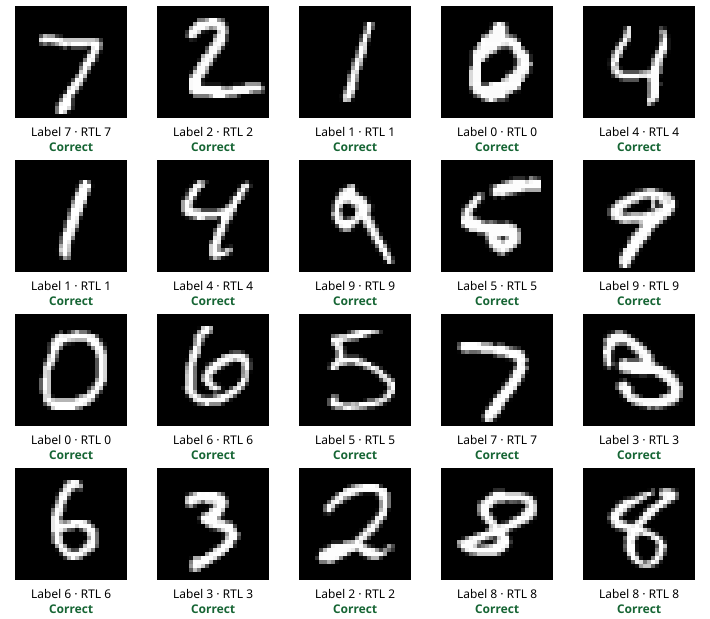

# Implicit-Im2col Accelerator

FPGA convolution accelerators implementing **NHWC and NCHW**, with autonomous memory-backed layer chaining, per-output-channel bias, configurable output quantization and combinational ReLU.

Both implementations use a 10×10 systolic array, signed INT8 inputs/weights, wrapped INT32 accumulation, 32-bit configuration/external addresses and 8-bit local SRAM addresses. Base SRAM capacity is 15 KiB: 2.5 KiB input, 2.5 KiB kernel and 10 KiB output. Dense layers map to 1×1 convolutions.

The `conv_program` top runs a whole layer program from a single start pulse.
See [layer-program validation](reports/layer_program/README.md) for the current
programmed interface's RTL, timing and power results.

<!-- CURRENT_SUMMARY_START -->
## MNIST CNN results

The current `conv_program` release runs the trained **8,706-parameter MNIST CNN**.
Both layouts start from memory-resident descriptors and finish with biased INT32 logits.

| Metric | NHWC | Two-slot NCHW |
|---|---:|---:|
| Slice LUTs | 21,552 | 61,935 |
| Slice registers | 10,985 | 18,848 |
| BRAM tiles | 10 | 15 |
| DSPs | 115 | 215 |
| Estimated Fmax | 34.942 MHz | 26.589 MHz |
| 20 MHz setup WNS | +21.381 ns | +12.391 ns |
| Layer execution cycles | 132,353 | 96,169 |
| Descriptor word reads | 108 | 108 |
| Descriptor fetch and launch cycles | 119 | 119 |
| Start-to-done cycles | 132,472 | 96,288 |
| Chain latency at 20 MHz | 6.62360 ms | 4.81440 ms |
| Dynamic / static / total power at 20 MHz | 14 / 123 / 136 mW | 12 / 123 / 135 mW |
| Estimated energy at 20 MHz | 0.901 mJ | 0.650 mJ |
| Chain latency at own estimated Fmax | 3.79135 ms | 3.62139 ms |
| Dynamic / static / total power at own estimated Fmax | 24 / 123 / 147 mW | 16 / 123 / 139 mW |
| Estimated energy at own estimated Fmax | 0.557 mJ | 0.503 mJ |

Timing and power are Vivado post-synthesis estimates for Nexys Video
(`xc7a200tsbg484-1`). At their individual estimated Fmax, the layouts
were simulated at periods of 28.620 ns (NHWC) and 37.610 ns (NCHW).
Chain latency includes descriptor fetch and launch. Energy uses the native
activity window from accepted start to completion, including 100 ps of
netlist propagation. Estimates exclude external-memory and software energy.

<!-- CURRENT_SUMMARY_END -->

| Implementation | Source | Addressing |
|---|---|---|
| NHWC | [tiled/NHWC](tiled/NHWC/README.md) | Counter-based NHWC unrolling and activation feeding |
| NCHW | [tiled/NCHW](tiled/NCHW/README.md) | Central address generation, residue-swizzled input banking and two activation-vector data slots |

Tensor files use NCHW inputs, KCRS weights and NKPQ outputs in both implementations. Tensor-file order, unrolling order and physical SRAM banking are separate conventions. Convolution supports batching, independent height/width padding, stride and dilation, and reduction tiling with stored partial sums.

## Output processing

Completed outputs pass through:

```text
INT32 accumulator → optional INT32 bias → scale multiply → round/shift → INT8 clamp → optional ReLU
```

```python
biased = wrap_int32(accumulator + (bias[channel] if bias_enabled else 0))
product = biased * multiplier
output = saturate_int8(round_shift(product, shift)) if quantize else biased
output = max(0, output) if relu_enabled else output
```

The multiplier is an unsigned 32-bit numerator, with scale approximated by `multiplier / 2**shift`. A full signed 64-bit product and a wider rounding intermediate preserve precision before narrowing. Shift is 0–31; rounding selects arithmetic floor or nearest with ties away from zero. Quantization assumes symmetric signed integers with zero point zero; arbitrary affine zero points and per-channel multipliers are outside this implementation.

Bias, requantization and ReLU are independent descriptor controls. **Disabling requantization retains optional bias addition**, producing raw signed32 values; disable bias and ReLU as well to obtain the unmodified accumulator. This lets the MNIST final layer retain bias without narrowing its scores.

Partial sums stay INT32 across reduction jobs. Output processing is shared and applied only on completed external writes. Each external word contains one sign-extended INT8 value or one raw signed32 value; outputs are not packed. The descriptor's `cfg_relu_enable` is captured at layer acceptance. ReLU
uses a combinational sign clamp on completed writes, including signed32 output
when requantization is bypassed.

See [file and memory formats](tools/mnist/MEMORY_FORMAT.md) for parameter loading and output layout.

## Layer chaining and memory

Load the layer descriptors, input activations, weights and biases into backing
memory. Present the word address of the first descriptor on `program_base` and
pulse `start` for one clock while `chain_busy` is low. `conv_program` latches
the base, reads 27 consecutive 32-bit words per descriptor and issues that
descriptor to the existing `conv_chain` engine. It waits for layer completion
before fetching the next descriptor at `pc + 27`. The final descriptor's
`last` flag causes a one-cycle `chain_done` pulse after final writeback. Starts
while busy are ignored.

The descriptors and tensors share the same memory interface. A read samples the
word address on the rising clock edge and returns the word for capture on the
following edge. Writes commit on the rising edge. Lay out the records outside
all tensor output regions and point each layer's input base at its predecessor's
output region. The model exporter supplies geometry, memory bounds and
compatible addresses. See the [descriptor layout](tools/mnist/MEMORY_FORMAT.md#layer-descriptor-program).

`conv_chain` also remains available for callers that stream one descriptor at a
time through `descriptor_valid` and `descriptor_ready`. The MNIST runner
selects `conv_program`. Its testbench initializes and models backing memory,
then launches the program once. The hardware interface assumes fixed-latency
SRAM-style memory. Board memory integration is outside the supplied RTL.

## Run the accelerator

In Ubuntu/WSL, install the dependencies:

```bash
sudo apt update
sudo apt install python3 python3-numpy python3-pil iverilog
```

From the repository root, run an included MNIST image:

```bash
# Python-only integer inference
python3 tools/mnist/run.py --stage py_sim

# RTL simulation of both NHWC and NCHW
python3 tools/mnist/run.py --stage rtl
```

Use your own image:

```bash
python3 tools/mnist/run.py --stage py_sim --image digit.png
```

Use a **white digit on a black background**, centered with some margin. Images automatically resize to 28×28; inversion and centering are manual. Replace `py_sim` with `rtl` to check the image through the accelerator simulation.

Optional flags:

| Flag | Purpose |
|---|---|
| `--variant NHWC` or `--variant NCHW` | Simulate one RTL implementation |
| `--samples 20 --directed` | Run all retained CNN images and directed cases |
| `--model dense` | Run the original dense MNIST model and its retained images |
| `--label 7` | Record the expected digit for a custom image |
| `--out-dir runs/my_run` | Choose a new output folder |

Otherwise, a unique folder under `runs/` is created and its path is printed. Predictions are in `results.json`; tensors are under `python/<case>/` or `<architecture>/<case>/`:

- `raw_outputs.hex`: actual write data, including enabled hardware ReLU.
- `rtl_outputs.hex`: verified chained outputs in increasing tensor-address order.

The four CNN layers write 1,936, 128, 32 and ten words per image. Passing the
arithmetic check and correctly classifying a digit are recorded independently.

## MNIST demonstration

```text
28×28 image → Conv16 + ReLU → Conv8 + ReLU → flatten 128
            → Dense32 + ReLU → Dense10 → INT32 logits → software argmax
```

The [University of Florida course model](https://cmp.phys.ufl.edu/PHZ4710/files/unit7/mnist.html#train-network)
uses two valid, stride-2 convolutions. Flatten reinterprets the previous output
in external memory. Each dense layer executes as a **1×1 convolution at a single
spatial position**.

| Layer | Convolution input (NCHW) | Kernel (KCRS) | Output (NKPQ) | Stride |
|---|---|---|---|---:|
| Conv16 | 1×1×28×28 | 16×1×8×8 | 1×16×11×11 | 2 |
| Conv8 | 1×16×11×11 | 8×16×5×5 | 1×8×4×4 | 2 |
| Dense32 | 1×128×1×1 | 32×128×1×1 | 1×32×1×1 | 1 |
| Dense10 | 1×32×1×1 | 10×32×1×1 | 1×10×1×1 | 1 |

Keras flattens in HWC order. The first Dense weights are permuted at export to
match both implementations' external CHW order. Requantization and hardware
ReLU apply to the first three layers. Bias stays enabled on the final layer
with raw INT32 output. Software argmax uses logits directly.

The [training notebook](tools/mnist/MNIST_Training_Test_3_CNN.ipynb) keeps
Adam 0.001, batch size 128, a 20% validation split and seed 196. Over 40 epochs,
validation accuracy peaked at **98.42%** at epoch 34. Epoch 17 reached
**98.30%** and the lowest validation loss, **0.06563**. We selected epoch 17
before test evaluation and calibrated on the 48,000 training images.

The selected checkpoint reached **98.65% floating-point and 98.62% INT8 accuracy**
on 10,000 test images, a **0.03 percentage-point** drop. The independent
integer reference matched every final score. Both RTL layouts matched all
2,106 values per image across 20 retained test images. Each layout classified
20/20 correctly on that subset.
See [training metrics](tools/mnist/training_cnn/METRICS.json) and
[RTL replay results](reports/layer_program/rtl_results.json).



## Cycle and timing analysis

Both accelerators use identical CNN inputs and parameters. Resources and timing
come from Vivado post-synthesis reports for Nexys Video `xc7a200tsbg484-1`.

| Layer | NHWC cycles | NCHW cycles |
|---|---:|---:|
| Conv16 | 81,938 | 44,163 |
| Conv8 | 38,105 | 37,778 |
| Dense32 | 11,383 | 13,134 |
| Dense10 | 927 | 1,094 |
| Layer execution subtotal | 132,353 | 96,169 |
| Descriptor fetch and launch | 119 | 119 |
| Full chain | 132,472 | 96,288 |

NCHW takes **36,184 fewer full-chain cycles (27.31%)** than NHWC on this CNN. Conv16 alone
saves **37,775 cycles**. Both implementations run **22 jobs** and spend the
same cycles on feature and weight transfers in Conv16. NCHW saves **38,192
core-execution cycles** there, with **374 more address-setup cycles** and
**43 more layer-planning cycles**. Across both Dense layers, NHWC saves
**1,918 cycles**, where NCHW's extra setup and core startup are visible.

### Worst paths

| Implementation | Worst path | Data delay | Logic levels | Interpretation |
|---|---|---:|---:|---|
| NHWC | `u_chain/u_accelerator/u_core/u_datapath/g_output[2].u_accumulator/u_sram/rdata_reg[1]/C` → `mem_wdata[0]` | 25.610ns | 46 | Completed-output writeback |
| NCHW | `u_chain/u_accelerator/tap_mode_reg_rep__5/C` → `u_chain/u_accelerator/p_0_out__0/A[16]` | 33.803ns | 68 | Scheduler bank/address planning |

See [synthesis and simulation timing](reports/layer_program/native_results.json) for constraints, setup
paths and the relation between the estimate and the actual simulation clocks.

### Power and energy

At 20 MHz, NCHW has **27.31% lower full-chain latency** and **27.85% lower
estimated energy** than NHWC. At each layout’s own estimated Fmax, NCHW has
**4.48% lower latency** and **9.68% lower estimated energy**.

Native SAIF covers one full inference per layout and clock, including all
descriptor fetches. At both clocks, it annotates **87%** of NHWC design nets
and **85%** of NCHW design nets. Vivado rounds power to the nearest milliwatt.
See the [native capture results](reports/layer_program/native_results.json).

## Validation and provenance

The notebook's INT8 inference matches an independent reference on the complete
test set. Both RTL implementations pass 20 retained test-image cases and three
directed controls. The original dense runner also passes a retained case on each
layout. All four native post-synthesis runs matched RTL outputs and cycle
counts. See the [source and capture identities](reports/layer_program/source_and_capture_identity.json)
and [per-layer RTL results](reports/layer_program/rtl_results.json).

These results describe RTL simulation and Vivado post-synthesis estimates.
Out-of-context clock placement, activity coverage and external-memory energy
limit their interpretation as board results.

## Credits

Original systolic-array foundation: [kaggar11/systolic_4x4arr](https://github.com/kaggar11/systolic_4x4arr). Algorithmic reference: Zhou et al., *Characterizing and Demystifying the Implicit Convolution Algorithm on Commercial Matrix-Multiplication Accelerators*, [arXiv:2110.03901](https://doi.org/10.48550/arXiv.2110.03901). Course/reference-model attribution is retained in `conv_golden.py`.

The [CNN notebook](tools/mnist/MNIST_Training_Test_3_CNN.ipynb) adapts the original notebook’s training and export workflow to the exact [University of Florida PHZ4710 CNN](https://cmp.phys.ufl.edu/PHZ4710/files/unit7/mnist.html). The [original notebook](tools/mnist/MNIST_Training_Test_3_.ipynb) remains available for the dense model.

AI assistance: Codex and GPT-6.1 Sol contributed to RTL, Python tooling, verification and documentation.
