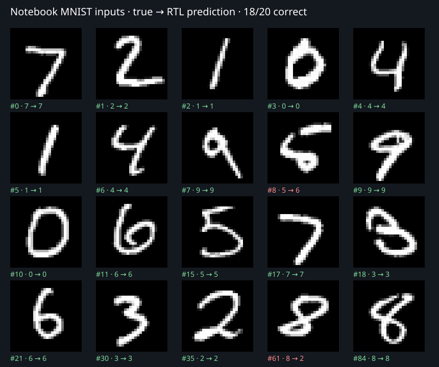

# Implicit-Im2col Accelerator

FPGA convolution accelerators implementing **NHWC and NCHW**, with descriptor-based layer chaining, per-output-channel bias and configurable output quantization.

Both implementations use a 10×10 systolic array, signed INT8 inputs/weights, wrapped INT32 accumulation, 32-bit configuration/external addresses and 8-bit local SRAM addresses. Base SRAM capacity is 15 KiB: 2.5 KiB input, 2.5 KiB kernel and 10 KiB output. Dense layers map to 1×1 convolutions.

<!-- CURRENT_SUMMARY_START -->
The table combines hardware comparisons with a trained **784→128→10 MNIST network**. Quantization includes bias, scaling, rounding/shift and saturation. Hidden ReLU runs in software/testbench; final scores retain biased INT32 precision.

| Metric | NHWC (No quant logic → With quant logic) | NCHW (No quant logic → With quant logic) |
|---|---:|---:|
| LUTs | 18,792 → 21,315 (+13.426%) | 61,055 → 61,703 (+1.061%) |
| Flip-flops | 9,900 → 10,293 (+3.970%) | 17,995 → 18,083 (+0.489%) |
| BRAM tiles | 15 → 10 (-33.333%) | 15 → 15 (+0.000%) |
| DSPs | 111 → 115 (+3.604%) | 206 → 210 (+1.942%) |
| Estimated Fmax | 38.583 MHz → 36.015 MHz (-6.656%) | 26.588 MHz → 26.619 MHz (+0.117%) |
| MNIST accelerator cycles | 264,976 | 299,366 |
| Latency at 20 MHz | 13.2488 ms | 14.9683 ms |
| Total power at 20 MHz | 135 mW | 134 mW |
| Inference energy at 20 MHz | 1.789 mJ | 2.006 mJ |
| Latency at own Fmax | 7.3573 ms | 11.2466 ms |
| Total power at own Fmax | 145 mW | 138 mW |
| Inference energy at own Fmax | 1.067 mJ | 1.552 mJ |

Arrows show **unquantized → quantized**, with percentage change relative to the unquantized value. Workload rows show the quantized accelerator only; no matching unquantized notebook measurement is available. Native Fmax analysis uses 27.766 ns for NHWC and 37.568 ns for NCHW (36.015 and 26.618 MHz); NCHW's 37.567 ns estimated minimum period rounds up by 1 ps to match simulator clock precision. Latency/energy use the actual simulated clock. The unquantized baseline also predates descriptor chaining and uses a different synthesis thread count, so hardware changes include wrapper and mapping effects.

Latency counts accelerator work; energy includes two descriptor-gap cycles and a 100 ps netlist propagation offset. Software processing and external-memory energy are excluded. All clocks and power are post-synthesis estimates, without routed timing closure or board validation.

<!-- CURRENT_SUMMARY_END -->

| Implementation | Source | Addressing |
|---|---|---|
| NHWC | [tiled/NHWC](tiled/NHWC/README.md) | Counter-based NHWC unrolling and activation feeding |
| NCHW | [tiled/NCHW_centralized](tiled/NCHW_centralized/README.md) | Central address generation, residue-swizzled input banking and two activation-vector data slots |

Tensor files use NCHW inputs, KCRS weights and NKPQ outputs in both implementations. Tensor-file order, unrolling order and physical SRAM banking are separate conventions. Convolution supports batching, independent height/width padding, stride and dilation, and reduction tiling with stored partial sums.

## Output processing

Completed outputs pass through:

```text
INT32 accumulator → optional INT32 bias → scale multiply → round/shift → INT8 clamp
```

```python
biased = wrap_int32(accumulator + (bias[channel] if bias_enabled else 0))
product = biased * multiplier
output = saturate_int8(round_shift(product, shift)) if quantize else biased
```

The multiplier is an unsigned 32-bit numerator, with scale approximated by `multiplier / 2**shift`. A full signed 64-bit product and a wider rounding intermediate preserve precision before narrowing. Shift is 0–31; rounding selects arithmetic floor or nearest with ties away from zero. Quantization assumes symmetric signed integers with zero point zero; arbitrary affine zero points and per-channel multipliers are outside this implementation.

Bias and requantization are independent descriptor controls. **Disabling requantization retains optional bias addition**, producing raw signed32 values; disable both to obtain the unmodified accumulator. This lets the MNIST final layer retain bias without narrowing its scores.

Partial sums stay INT32 across reduction jobs. Output processing is shared and applied only on completed external writes. Each external word contains one sign-extended INT8 value or one raw signed32 value; outputs are not packed. Nonlinear operations, including ReLU, run in testbench/software on actual accelerator outputs.

See [file and memory formats](tools/mnist/MEMORY_FORMAT.md) for parameter loading and output layout.

## Layer chaining and memory

The `conv_chain` top accepts a layer when `descriptor_valid && descriptor_ready`. The descriptor supplies geometry, input/kernel/output bases, bias enable/base, quantization enable, multiplier, shift, rounding mode and `descriptor_last`.

The wrapper launches the tiled `conv_accelerator`, retains the final-layer flag and keeps `chain_busy` asserted between descriptors. Each layer finishes all output writes before another is accepted; no reset is needed between layers. The producer holds each descriptor until acceptance and supplies the next input base matching the previous output region.

There is no internal descriptor queue/fetcher, automatic base-address calculation or overlap between layers. The producer owns shape compatibility, memory bounds and non-overlap. The external interface uses serialized, fixed-latency SRAM-style transfers: enabled synchronous reads and edge writes. The testbench supplies external memory and descriptors; AXI, DDR/MIG and a processor are outside this release.

## Run the accelerator

Requirements: Python 3, NumPy for MNIST replay, and Icarus Verilog (`iverilog`/`vvp`). No training framework or dataset download is needed for the retained demo.

Verify released source and model hashes without launching tools:

```bash
python3 tools/mnist/run.py --stage prepare --out-dir runs/mnist_prepare
```

Replay one complete inference on each implementation at 20 MHz:

```bash
python3 tools/mnist/run.py --stage rtl --samples 1 --out-dir runs/mnist_rtl
```

Use `--samples 20 --directed` for all retained images and three directed reduction/bias cases per implementation. See [MNIST replay](tools/mnist/README.md), [single-layer controls](tiled/NHWC/README.md) and [synthesis preparation](tools/vivado_synthesis/README.md). Generated outputs require a new directory and are excluded from Git.

For a different input, use `--image digit.png` (exactly 28×28; requires Pillow) or `--input-tensor input.hex` (784 already-quantized INT8 hex values). The runner generates fresh integer-reference outputs and checks all RTL intermediates. For different convolution tensors/shapes, use either implementation's `run_case.py` with input/kernel files and optional bias/scale controls. See [custom input examples](tools/mnist/README.md#use-a-different-image-or-tensor).

## MNIST demonstration

```text
28×28 image → flatten 784 → Dense 128 → external ReLU
                         → Dense 10  → raw32 scores → software argmax
```

The hidden layer uses bias and requantization. The final layer uses bias with requantization disabled. ReLU transforms actual accelerator writes before they feed the next layer; reference tensors never replace those writes. The testbench assigns no simulated time to software ReLU, so its latency/energy is unmeasured.

The included [Keras training notebook](tools/mnist/MNIST_Training_Test_3_.ipynb) uses Keras Dense128 with ReLU, then Dense10 linear; Adam 0.001, 12 epochs, batch size 128, 20% validation, final-epoch weights and calibration over the 48,000 training images. Training uses seed 196 for reproducibility. All notebook cell source text is preserved; saved outputs/UI metadata are removed from the published copy.

Evaluation reports **97.53% floating-point and 97.51% integer accuracy** on 10,000 test images, a **0.02 percentage-point** drop. The independent integer reference matches every final score from notebook validation. RTL validation covers 20 selected images per implementation: all 138 intermediate/final values per image match, with 18/20 classifications correct. That subset is not a full-test-set RTL accuracy measurement. See [metrics](tools/mnist/training/METRICS.json) and [notebook provenance](tools/mnist/training/PROVENANCE.json).



## Results and analysis

Same network, parameters and 20 MHz comparison clock; both accelerators exclude nonlinear hardware. Resources/timing are Vivado post-synthesis estimates for Nexys Video `xc7a200tsbg484-1`.


For this workload, **NHWC uses 11.49% fewer cycles, 65.46% fewer LUTs and 45.24% fewer DSPs than NCHW**. Conversely, NCHW takes 12.98% more cycles than NHWC; these percentages have different denominators.

At each design's estimated Fmax, NHWC's accelerator latency is **34.58% lower than NCHW's**, combining fewer cycles with a higher clock. Compared with each design at 20 MHz, latency falls **44.47% for NHWC** and **24.86% for NCHW**, using the actual simulated clock periods in the table.

NCHW's **34,390 additional cycles** break down as follows:

- **24,960 cycles — core address/vector startup:** Compared with NHWC's simpler counter initialization, NCHW configures spatial divisions, bank/address movements and per-row starting addresses before delivering its first input vector, adding **24 cycles per job × 1,040 jobs**.
- **9,360 cycles — input-placement setup:** Compared with NHWC's direct counter-based input placement, NCHW calculates spatial pitches and bank/address increments before loading each job's inputs into local SRAM, adding **9 cycles per job × 1,040 jobs**.
- **70 cycles — layer capacity planning:** Compared with NHWC's three sequential divisions for choosing channel chunks and tile sizes, NCHW performs seven divisions plus intermediate calculations to accommodate its spatial banking, adding **35 cycles per layer × 2 layers**.

Both cores have **21 advancing computation/fill/drain cycles per job** for this network. The first-job trace shows NHWC PRIME/LOAD/RUN = 5/10/21 cycles; NCHW = 1/10/49, with 28 RUN cycles waiting before the advancing pass. Address setup overlaps weight loading, so those times must not be added twice.

Dense 1×1 layers do not reduce the number of jobs using NCHW's more general spatial machinery. The first layer contributes about 98.72% of accelerator cycles; serialized weight transfers consume 203,264 cycles in both designs: 76.71% of NHWC time and 67.90% of NCHW time. These results describe these implementations on this network; other convolution shapes need separate measurement.

### Quantized versus unquantized accelerator

The unquantized baseline is the retained raw-output design without output bias, scale multiplication, shift/rounding or saturation logic. Both versions use INT8 operands and INT32 accumulation. This compares two synthesized designs; disabling requantization on the current accelerator does not remove its output-processing circuitry.

Both use Nexys Video `xc7a200tsbg484-1`, A10 and the same base SRAM capacity. The opening table shows counts and changes relative to the unquantized baseline: `(quantized - unquantized) / unquantized × 100%`, calculated from unrounded counts/Fmax.

Counts, estimated Fmax and percentage changes are combined in the opening summary table.

Both designs add four DSPs. NHWC's five-tile BRAM reduction comes from output SRAM mapping to distributed RAM, including 1,760 LUTRAMs, while storage capacity stays unchanged. This mapping contributes to the LUT increase. NHWC's worst path moves into completed-output processing and estimated Fmax decreases 6.656%; NCHW remains limited by scheduler bank/address arithmetic, with its 0.117% Fmax increase reflecting a small whole-design mapping variation.

These are retained full-design results: the unquantized baseline also predates descriptor chaining, and requested synthesis threads differ (two versus eight). The changes therefore include wrapper and synthesis-mapping effects, rather than isolating only the quantizer. See [the detailed comparison](reports/current/QUANTIZED_VS_RAW.md) and [underlying values](reports/current/quantized_vs_raw.json). No matched unquantized MNIST power/latency measurement is claimed.

### Worst paths

| Implementation | Worst path | Data delay | Logic levels | Interpretation |
|---|---|---:|---:|---|
| NHWC | Accumulator SRAM read register → `mem_wdata[0]` | 24.757 ns | 45 | Completed-output bias/scale/round/saturation writeback limits timing |
| NCHW | `tap_mode` register → scheduler DSP input `A[16]` | 33.761 ns | 68 | Bank/address planning arithmetic remains the limiting path |

All ten worst setup paths per implementation are included in [current results](reports/current/README.md). Both miss the 50 MHz synthesis target; timing is reanalyzed at 20 MHz for the common-clock comparison. Estimated Fmax is reported separately and is not a measured board clock or speedup.

### Power and energy

See the opening summary table for power and energy estimates at 20 MHz and each design’s estimated Fmax.

NCHW's estimated total power is **0.74% lower**, but energy is **12.14% higher**, relative to NHWC, because inference lasts longer. Native XSim activity covers one full inference per implementation, including two descriptor-gap cycles and a 100 ps netlist propagation offset beyond accelerator busy time. Annotation coverage is 87% NHWC and 79% NCHW; reset/activity warnings and incomplete coverage limit interpretation. Software and external-memory power are excluded.

At each design’s own estimated Fmax, NHWC uses **31.26% less estimated inference energy than NCHW**. Relative to each design at 20 MHz, energy decreases **40.35% for NHWC** and **22.62% for NCHW**: higher clock power is outweighed by shorter elapsed time. These comparisons retain the same workload and output values.

See [quantization versus raw-output hardware](reports/current/QUANTIZED_VS_RAW.md) for retained older controls and caveats. Historical 1 MHz measurements retain their original workload and release labels.

## Validation and provenance

The current RTL is byte-identical to the accepted quantization-only synthesis sources. Verification covers 46 matched RTL pipeline cases, eight four-state controls and two native post-synthesis inferences at 20 MHz across the pair. Two additional native inferences at each design’s estimated Fmax also passed, using the actual simulated periods documented above. Source/model hashes, per-layer counters, report excerpts and publication provenance are in [current results](reports/current/README.md). Public-command packaging checks are recorded separately from the workload campaign.

These are simulation and post-synthesis results. There is no placement/routing, bitstream, board inference or measured physical power claim. Out-of-context clock-placement/skew uncertainty also limits timing estimates. Previous four-way and chaining-only results remain historical.

## Credits

Original systolic-array foundation: [kaggar11/systolic_4x4arr](https://github.com/kaggar11/systolic_4x4arr). Algorithmic reference: Zhou et al., *Characterizing and Demystifying the Implicit Convolution Algorithm on Commercial Matrix-Multiplication Accelerators*, [arXiv:2110.03901](https://doi.org/10.48550/arXiv.2110.03901). Course/reference-model attribution is retained in `conv_golden.py`.

The included [MNIST training notebook](tools/mnist/MNIST_Training_Test_3_.ipynb) is the model/training/quantization source. Published weights, biases and scales come from executing its training/export cells with seed 196; [provenance](tools/mnist/training/PROVENANCE.json) records source identity.

AI assistance: Codex and GPT-6.1 Sol contributed to RTL, Python tooling, verification and documentation.
