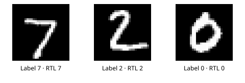

# Implicit-Im2col Accelerator

FPGA convolution accelerators implementing **NHWC and NCHW**, with descriptor-based layer chaining, per-output-channel bias, configurable output quantization and combinational ReLU.

Both implementations use a 10×10 systolic array, signed INT8 inputs/weights, wrapped INT32 accumulation, 32-bit configuration/external addresses and 8-bit local SRAM addresses. Base SRAM capacity is 15 KiB: 2.5 KiB input, 2.5 KiB kernel and 10 KiB output. Dense layers map to 1×1 convolutions.

<!-- CURRENT_SUMMARY_START -->
The table combines hardware comparisons with a trained **8,706-parameter MNIST CNN**.
The CNN uses quantization and combinational ReLU on completed hidden-layer writes.
Final scores retain biased INT32 precision.

| Metric | NHWC (Quantization → Quantization + ReLU) | NCHW (Quantization → Quantization + ReLU) |
|---|---:|---:|
| LUTs | 21,315 → 21,455 (+0.66%) | 61,703 → 61,356 (-0.56%) |
| Flip-flops | 10,293 → 10,297 (+0.04%) | 18,083 → 18,188 (+0.58%) |
| BRAM tiles | 10 → 10 (+0.00%) | 15 → 15 (+0.00%) |
| DSPs | 115 → 115 (+0.00%) | 210 → 215 (+2.38%) |
| Estimated Fmax | 36.015 MHz → 34.942 MHz (-2.98%) | 26.619 MHz → 26.583 MHz (-0.14%) |
| MNIST accelerator cycles | 132,353 | 96,169 |
| Latency at 20 MHz | 6.6177 ms | 4.8084 ms |
| Power at 20 MHz (dynamic / static / total) | 14 / 123 / 137 mW | 12 / 123 / 135 mW |
| Inference energy at 20 MHz | 0.907 mJ | 0.649 mJ |
| Latency at own Fmax | 3.7879 ms | 3.6177 ms |
| Power at own Fmax (dynamic / static / total) | 25 / 123 / 147 mW | 16 / 123 / 139 mW |
| Inference energy at own Fmax | 0.557 mJ | 0.503 mJ |

Arrows show **quantization only → quantization with ReLU**, with percentage change
relative to the quantization-only design. Cycle, latency, power and energy rows
describe the CNN on the ReLU-enabled design. The 20 MHz row uses a common
50 ns period. Individual estimated-Fmax rows use the actual simulated periods
of 28.620 ns for NHWC and 37.618 ns for NCHW.

Latency counts accelerator work. Energy uses the native activity window, which
also includes six descriptor-gap cycles and a 100 ps netlist propagation offset.
External-memory and software energy are excluded. Timing and power are
post-synthesis estimates.

<!-- CURRENT_SUMMARY_END -->

| Implementation | Source | Addressing |
|---|---|---|
| NHWC | [tiled/NHWC](tiled/NHWC/README.md) | Counter-based NHWC unrolling and activation feeding |
| NCHW | [tiled/NCHW](tiled/NCHW/README.md) | Central address generation, residue-swizzled input banking and two activation-vector data slots |

Tensor files use NCHW inputs, KCRS weights and NKPQ outputs in both implementations. Tensor-file order, unrolling order and physical SRAM banking are separate conventions. Convolution supports batching, independent height/width padding, stride and dilation, and reduction tiling with stored partial sums.

## Output processing

Completed outputs pass through:

```text
INT32 accumulator → optional INT32 bias → scale multiply → round/shift → INT8 clamp → optional ReLU
```

```python
biased = wrap_int32(accumulator + (bias[channel] if bias_enabled else 0))
product = biased * multiplier
output = saturate_int8(round_shift(product, shift)) if quantize else biased
output = max(0, output) if relu_enabled else output
```

The multiplier is an unsigned 32-bit numerator, with scale approximated by `multiplier / 2**shift`. A full signed 64-bit product and a wider rounding intermediate preserve precision before narrowing. Shift is 0–31; rounding selects arithmetic floor or nearest with ties away from zero. Quantization assumes symmetric signed integers with zero point zero; arbitrary affine zero points and per-channel multipliers are outside this implementation.

Bias, requantization and ReLU are independent descriptor controls. **Disabling requantization retains optional bias addition**, producing raw signed32 values; disable bias and ReLU as well to obtain the unmodified accumulator. This lets the MNIST final layer retain bias without narrowing its scores.

Partial sums stay INT32 across reduction jobs. Output processing is shared and applied only on completed external writes. Each external word contains one sign-extended INT8 value or one raw signed32 value; outputs are not packed. The descriptor's `cfg_relu_enable` is captured at layer acceptance. ReLU
uses a combinational sign clamp on completed writes and adds zero cycles in
the matched CNN check. It also works on signed32 output when requantization is
bypassed.

See [file and memory formats](tools/mnist/MEMORY_FORMAT.md) for parameter loading and output layout.

## Layer chaining and memory

The `conv_chain` top accepts a layer when `descriptor_valid && descriptor_ready`. The descriptor supplies geometry, input/kernel/output bases, bias enable/base, quantization enable, multiplier, shift, rounding mode, ReLU enable and `descriptor_last`.

The wrapper launches the tiled `conv_accelerator`, retains the final-layer flag and keeps `chain_busy` asserted between descriptors. Each layer finishes all output writes before another is accepted; no reset is needed between layers. The producer holds each descriptor until acceptance and supplies the next input base matching the previous output region.

There is no internal descriptor queue/fetcher, automatic base-address calculation or overlap between layers. The producer owns shape compatibility, memory bounds and non-overlap. The external interface uses serialized, fixed-latency SRAM-style transfers: enabled synchronous reads and edge writes. The testbench supplies external memory and descriptors; AXI, DDR/MIG and a processor are outside this release.

## Run the accelerator

In Ubuntu/WSL, install the dependencies:

```bash
sudo apt update
sudo apt install python3 python3-numpy python3-pil iverilog
```

From the repository root, run an included MNIST image:

```bash
# Python-only integer inference
python3 tools/mnist/run.py --stage py_sim

# RTL simulation of both NHWC and NCHW
python3 tools/mnist/run.py --stage rtl
```

Use your own image:

```bash
python3 tools/mnist/run.py --stage py_sim --image digit.png
```

Use a **white digit on a black background**, centered with some margin. Images automatically resize to 28×28; inversion and centering are manual. Replace `py_sim` with `rtl` to check the image through the accelerator simulation.

Optional flags:

| Flag | Purpose |
|---|---|
| `--variant NHWC` or `--variant NCHW` | Simulate one RTL implementation |
| `--samples 20 --directed` | Run all retained CNN images and directed cases |
| `--model dense` | Run the original dense MNIST model and its retained images |
| `--label 7` | Record the expected digit for a custom image |
| `--out-dir runs/my_run` | Choose a new output folder |

Otherwise, a unique folder under `runs/` is created and its path is printed. Predictions are in `results.json`; tensors are under `python/<case>/` or `<architecture>/<case>/`:

- `raw_outputs.hex`: actual write data, including enabled hardware ReLU.
- `rtl_outputs.hex`: verified chained outputs in increasing tensor-address order.

The four CNN layers write 1,936, 128, 32 and ten words per image. Passing the
arithmetic check and correctly classifying a digit are recorded independently.

## MNIST demonstration

```text
28×28 image → Conv16 + ReLU → Conv8 + ReLU → flatten 128
            → Dense32 + ReLU → Dense10 → INT32 logits → software argmax
```

The [University of Florida course model](https://cmp.phys.ufl.edu/PHZ4710/files/unit7/mnist.html#train-network)
uses two valid, stride-2 convolutions. Flatten reinterprets the previous output
in external memory. Each dense layer executes as a **1×1 convolution at a single
spatial position**.

| Layer | Convolution input (NCHW) | Kernel (KCRS) | Output (NKPQ) | Stride |
|---|---|---|---|---:|
| Conv16 | 1×1×28×28 | 16×1×8×8 | 1×16×11×11 | 2 |
| Conv8 | 1×16×11×11 | 8×16×5×5 | 1×8×4×4 | 2 |
| Dense32 | 1×128×1×1 | 32×128×1×1 | 1×32×1×1 | 1 |
| Dense10 | 1×32×1×1 | 10×32×1×1 | 1×10×1×1 | 1 |

Keras flattens in HWC order. The first Dense weights are permuted at export to
match both implementations' external CHW order. Requantization and hardware
ReLU apply to the first three layers. Bias stays enabled on the final layer
with raw INT32 output. Software argmax uses logits directly.

The [training notebook](tools/mnist/MNIST_Training_Test_3_CNN.ipynb) keeps
Adam 0.001, batch size 128, a 20% validation split and seed 196. Over 40 epochs,
validation accuracy peaked at **98.42%** at epoch 34. Epoch 17 reached
**98.30%** and the lowest validation loss, **0.06563**. We selected epoch 17
before test evaluation and calibrated on the 48,000 training images.

The selected checkpoint reached **98.65% floating-point and 98.62% INT8 accuracy**
on 10,000 test images, a **0.03 percentage-point** drop. The independent
integer reference matched every final score. Both RTL layouts matched all
2,106 values per image for the same 20 test indices used in the dense baseline.
Each layout classified 20/20 correctly on that subset.
See [training metrics](tools/mnist/training_cnn/METRICS.json) and
[current validation](reports/mnist_cnn_relu/README.md).



## Results and analysis

Both accelerators use identical CNN inputs and parameters. Resources and timing
come from Vivado post-synthesis reports for Nexys Video `xc7a200tsbg484-1`.

| Layer | NHWC cycles | NCHW cycles |
|---|---:|---:|
| Conv16 | 81,938 | 44,163 |
| Conv8 | 38,105 | 37,778 |
| Dense32 | 11,383 | 13,134 |
| Dense10 | 927 | 1,094 |
| Total | 132,353 | 96,169 |

NCHW takes **36,184 fewer cycles (27.34%)** than NHWC on this CNN. Conv16 alone
saves **37,775 cycles**. Both implementations run **22 jobs** and spend the
same cycles on feature and weight transfers in Conv16. NCHW saves **38,192
core-execution cycles** there, with **374 more address-setup cycles** and
**43 more layer-planning cycles**. Across both Dense layers, NHWC saves
**1,918 cycles**, where NCHW's extra setup and core startup are visible.
Matched hardware and software ReLU controls produced the same outputs and
cycle counts on both implementations.

### Quantized accelerator with and without ReLU

The opening table compares the retained quantization-only designs against the
current combinational-ReLU designs. Both use the same FPGA part, 10×10 array
and precision. Deltas are relative to each architecture's own quantization-only
baseline. [Prior quantization-only results](reports/current/README.md).

Relative to the retained unquantized baseline, the complete bias, quantization
and ReLU designs change by the amounts below. This baseline predates chaining.

- NHWC versus retained unquantized: LUTs +14.17%, Flip-flops +4.01%, BRAM tiles -33.33%, DSPs +3.60%, Estimated Fmax -9.44%.
- NCHW versus retained unquantized: LUTs +0.49%, Flip-flops +1.07%, BRAM tiles +0.00%, DSPs +4.37%, Estimated Fmax -0.02%.

### Worst paths

| Implementation | Worst path | Data delay | Logic levels | Interpretation |
|---|---|---:|---:|---|
| NHWC | `u_accelerator/u_core/u_datapath/g_output[2].u_accumulator/u_sram/rdata_reg[1]/C` → `mem_wdata[0]` | 25.610ns | 46 | Completed-output writeback |
| NCHW | `u_accelerator/tap_mode_reg/C` → `u_accelerator/p_0_out__0/A[16]` | 33.812ns | 68 | Scheduler bank/address planning |

See [timing reports](reports/mnist_cnn_relu/README.md) for constraints, setup
paths and the relation between the estimate and the actual simulation clocks.

### Power and energy

At 20 MHz, NCHW has **27.34% lower latency**
and **28.40% lower estimated energy** than NHWC.
At each layout’s own estimated Fmax, the NCHW advantage is
**4.49% for latency** and
**9.69% for energy**.

Native SAIF covers one inference per layout and clock, including three
two-cycle descriptor gaps and the primitive propagation offset. Read
[the measurement details](reports/mnist_cnn_relu/README.md) for activity
annotation coverage and tool warnings.

## Validation and provenance

The notebook's INT8 inference matches an independent reference on the complete
test set. Both RTL implementations pass 20 trained-image cases and three
directed controls. The original dense runner also passes a retained case on each
layout. All four native post-synthesis runs matched RTL outputs and cycle counts. See [current results](reports/mnist_cnn_relu/README.md)
for source hashes, configuration, per-layer counters and report provenance.
The [November 16 release report](reports/current/README.md) retains the dense
model and quantization-only comparison.

These results describe RTL simulation and Vivado post-synthesis estimates.
Out-of-context clock placement, activity coverage and external-memory energy
limit their interpretation as board results.

## Credits

Original systolic-array foundation: [kaggar11/systolic_4x4arr](https://github.com/kaggar11/systolic_4x4arr). Algorithmic reference: Zhou et al., *Characterizing and Demystifying the Implicit Convolution Algorithm on Commercial Matrix-Multiplication Accelerators*, [arXiv:2110.03901](https://doi.org/10.48550/arXiv.2110.03901). Course/reference-model attribution is retained in `conv_golden.py`.

The [CNN notebook](tools/mnist/MNIST_Training_Test_3_CNN.ipynb) adapts the original notebook’s training and export workflow to the exact [University of Florida PHZ4710 CNN](https://cmp.phys.ufl.edu/PHZ4710/files/unit7/mnist.html). The [original notebook](tools/mnist/MNIST_Training_Test_3_.ipynb) remains available for the dense model.

AI assistance: Codex and GPT-6.1 Sol contributed to RTL, Python tooling, verification and documentation.
